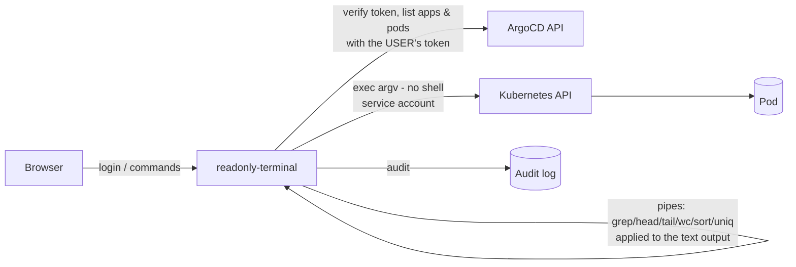

# argocd-readonly-pod-terminal

**A read-only, shell-free terminal into Kubernetes pods for ArgoCD users.**
Let monitoring and support teams *look* inside pods — browse folders, read logs and configs — without handing them ArgoCD's full **Exec** (a real shell).


---

## The problem

People often need to check something *inside* a running pod: "was the file created?", "what does the config say?", "what's in today's log?".
In ArgoCD the only built-in way is the **web terminal (Exec)** — and that is a **full shell**:

- Someone who only needs to *read* can also `rm`, edit configs, kill processes or run scripts.
- **Kubernetes RBAC and ArgoCD RBAC can't express "read-only exec"** — `pods/exec` (and ArgoCD's `exec, create`) is all-or-nothing; neither can restrict *which commands* run inside the shell.
- Handing out Exec to many people is an incident waiting to happen.

## The solution

A small web app that runs next to ArgoCD and gives users a terminal that **looks like a shell but only reads**:

- 🔑 **Log in with your ArgoCD account** — the token is verified by ArgoCD.
- 🧭 **Scoped by ArgoCD RBAC** — applications are listed with the *user's own* ArgoCD token, so users only see apps (and their pods) they're allowed to `get`.
- ✅ **Allow-listed commands only:** `ls cd pwd cat head tail grep find stat du wc`
- 🔗 **Pipes that never run in the pod:** `tail -n 200 app.log | grep -i error | wc -l`
- ⌨️ **Tab completion**, command history (↑/↓), copy & paste.
- 🧾 **Audit log** of every command (stdout + optional file).

```
$ tail -n 100 /var/log/app.log | grep -i error      ✅ allowed
$ grep -rn "timeout" /app/logs                      ✅ allowed
$ rm -rf /app                                       ⛔ 'rm' is not allowed
$ cat secret.env > /tmp/x                           ⛔ '>' is not supported
$ cat app.log | sh                                  ⛔ 'sh' can't be used after |
$ tail -f app.log                                   ⛔ 'tail -f' is not allowed
```

## How it works



### Why it stays read-only

| Layer | What it does |
|---|---|
| **No shell, ever** | The command is parsed by the server and sent to the Kubernetes exec API as an **argv array**. There is no `sh -c`, so `;`, `&&`, `\|\|`, `$( )`, backticks and `>` have nothing to run in — they are rejected with a clear message. |
| **Allow-list** | Only `ls cat head tail grep find stat du wc` (+ `cd`/`pwd`, handled server-side). Dangerous flags of allowed commands are blocked too: `find -delete/-exec/-fprint…`, `tail -f`, `grep -f`. |
| **Pipes outside the pod** | Only the first command runs in the container. `grep head tail wc sort uniq` after `\|` are applied **by the server to the text output**. |
| **Access check per request** | The pod must belong to an application the user can read in ArgoCD (resource tree fetched with the user's token). |
| **Limits** | 512 KB output cap, 20 s timeout per command, 1000-char command length. |
| **Least privilege** | Only the app's service account has `pods/get,list` + `pods/exec`. It **cannot** delete or edit anything. Users never get Kubernetes permissions. |
| **Audit** | Every command is logged with the ArgoCD username, namespace, pod and container. |

## Quick start

```bash
# 1. build & push
docker build -t <registry>/argocd-readonly-pod-terminal:1.0.0 .
docker push <registry>/argocd-readonly-pod-terminal:1.0.0

# 2. deploy (namespace argocd)
kubectl apply -f k8s/rbac.yaml
kubectl apply -f k8s/deployment.yaml   # set your image first
kubectl apply -f k8s/ingress.yaml      # set your host / TLS

# 3. open https://argocd.example.com/terminal/ and sign in with an ArgoCD account
```

### Configuration

| Env var | Default | Description |
|---|---|---|
| `ARGOCD_SERVER` | `https://argocd-server.argocd.svc.cluster.local` | ArgoCD API URL |
| `ARGOCD_INSECURE` | `false` | `true` to accept ArgoCD's self-signed in-cluster certificate |
| `BASE_PATH` | `` | Sub-path when served behind an ingress, e.g. `/terminal` |
| `AUDIT_LOG_FILE` | `` | Also append audit lines to this file (mount a PVC to keep it) |
| `PORT` | `3000` | Listen port |

### Giving someone read-only access

1. Create (or reuse) an ArgoCD account.
2. In `argocd-rbac-cm`, give it **read** on the projects it needs — e.g.
   ```
   p, role:readonly-team, applications, get, my-project/*, allow
   g, alice, role:readonly-team
   ```
3. **Don't** grant `exec, create`. Alice uses this terminal instead of the ArgoCD shell.

## Develop & test

```bash
npm install
npm test        # parser / allow-list / pipe tests (node --test)
KUBECONFIG=~/.kube/config ARGOCD_SERVER=https://localhost:8080 ARGOCD_INSECURE=true npm start
```

## Limitations & ideas

- Only text output; no binary downloads.
- No `tail -f` yet — a time-boxed, read-only "follow" stream is a natural next step.
- The audit log is stdout + optional file; shipping it to Loki/Elasticsearch is recommended for long-term retention.
- Containers without `ls`/`cat` (distroless) can't be browsed.

## License

[MIT](LICENSE)
